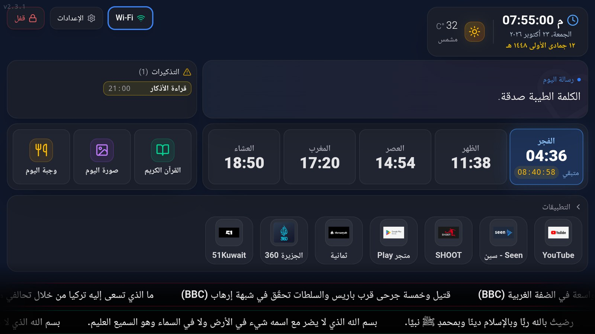
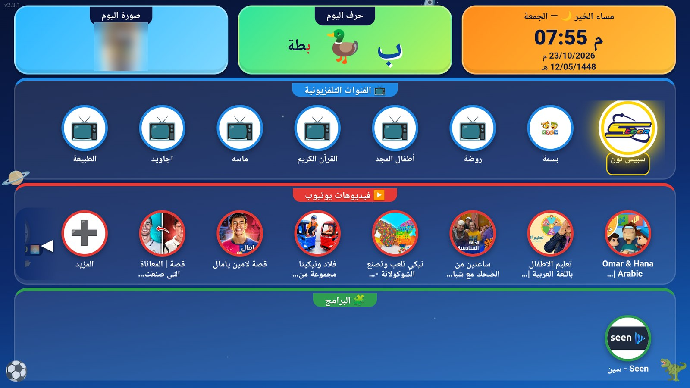
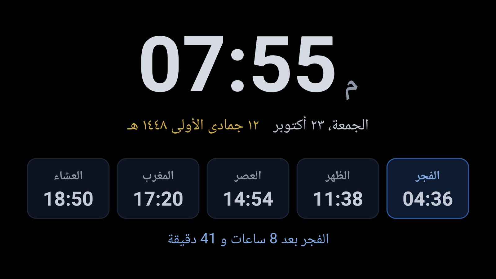

# TV Hub

مشروع موحّد يجمع `web_project` (لوحة المنزل) و`kids-tv-streaming-spec` (تلفاز غرفة الأطفال). يعمل على Android TV دون Fully Kiosk ودون SHTTPS.

| المجلد | المحتوى |
|---|---|
| `android/` | تطبيق TV Hub (`com.kidstv.home`). يعمل كواجهة رئيسية، فيه WebView، وخادم محلي على `127.0.0.1:8765`، وخادم إدارة للجوال على `:8080` |
| `web/` | الصفحات (Vite + TypeScript): `index` يختار الواجهة، و`home` لوحة المنزل، و`kids` واجهة الأطفال، و`shared/owner` قسم الأدمن |
| `DECISIONS.md` | القرارات ونتائج الاختبار الخام |

## لقطات من التلفازين (أكتوبر 2026)

**تلفاز غرفة المعيشة:** لوحة المعلومات. فيها الساعة والتاريخ الهجري، والطقس، ورسالة اليوم، والتذكيرات، ومواقيت الصلاة مع المتبقي للقادمة، والتطبيقات، وشريطا الأخبار والأذكار.



**تلفاز غرفة الأطفال:** صورة اليوم وحرف اليوم، والقنوات التلفزيونية (العناصر المقفلة تُظهر وقت إتاحتها)، وفيديوهات يوتيوب، والبرامج المسموحة. صورة اليوم مموّهة عمدًا في هذه اللقطة.



**شاشة التوقف (غرفة المعيشة):** الساعة، والتاريخ الميلادي والهجري، ومواقيت الصلاة، والوقت المتبقي للصلاة القادمة.



## البناء والنشر
```
cd android && powershell -File build.ps1          # tv-hub.apk
cd web && npm install && npm run lint && npm run build
npm run deploy -- <IP غرفة المعيشة>:5555               # ملفات البيانات الموجودة على التلفاز لا تُستبدل
```

## تجهيز جهاز جديد (مرة واحدة)
```
adb install tv-hub.apk
adb shell appops set com.kidstv.home MANAGE_EXTERNAL_STORAGE allow
# ضع config.json في /sdcard/tv_hub_private/ ثم: npm run deploy -- <device>
adb shell cmd package set-home-activity com.kidstv.home/.HomeActivity
# على Google TV يلزم أيضًا (انظر H-002):
adb shell pm disable-user --user 0 com.google.android.apps.tv.launcherx
adb shell pm disable-user --user 0 com.google.android.tungsten.setupwraith
```

**الأسهل الآن:** صفحة الجوال ← «الأطفال» ← «إعدادات البث ويوتيوب»، للخوادم والحساب ومفتاح يوتيوب، مع زر «اختبار الاتصال». التعديل اليدوي التالي ما زال ممكنًا.

**خوادم احتياطية للقنوات:** في `config.json`، داخل `userSettings.stream`:
```json
"baseUrl": "http://الخادم-الرئيسي:port",
"baseUrls": ["http://خادم-احتياطي-1:port", "http://خادم-احتياطي-2:port"]
```
- كلها للمزوّد نفسه، بنفس اسم المستخدم وكلمة المرور وأرقام القنوات.
- إذا تعطل خادم أو لم يُجب خلال 15 ث (أو أجاب ولم تظهر صورة خلال 30 ث)، يُغلق الاتصال وينتقل المشغّل للخادم التالي تلقائيًا.
- الخادم الذي نجح يُستخدم أولًا لمدة 30 دقيقة، ثم يعود الرئيسي أولًا.
- `baseUrls` اختياري: بدونه يعمل `baseUrl` وحده كما كان.
- بعد التعديل: انسخ الملف إلى `/sdcard/tv_hub_private/config.json`، ثم أعد تشغيل الصفحة. لا يحتاج إعادة بناء.

## الاختبار والصيانة
```
cd web && npm test                         # قواعد أوقات المشاهدة
npm run smoke -- <IP غرفة الأطفال>             # فحص أمني للتلفاز بعد كل نشر (16 فحصًا)
adb shell touch /sdcard/tv_hub_private/debug   # تفعيل DevTools مؤقتًا (ثم أعد تشغيل التطبيق)، والإلغاء بـ rm
```
- الصور (صورة اليوم والأيقونات المرفوعة) محفوظة داخل التطبيق، وadb لا يصل إليها. للنسخ الاحتياطي: صفحة الهاتف ← الصور ← «تنزيل كل الصور». **إلغاء تثبيت التطبيق يحذفها**، لكن التحديث (`adb install -r`) يحتفظ بها. صورة تُنسخ بـ adb إلى `/sdcard/tv_hub/today_images/` تُنقل إلى الداخل عند التشغيل التالي.
- كلمة مرور مفتاح التوقيع: `TVHUB_KS_PASS` أو `android/keystore.pass` (مستثنى من git). **انسخ المفتاح وكلمة مروره خارج الحاسب.**
- أوقات المشاهدة تعتمد ساعة التلفاز: أبقِ «التاريخ والوقت التلقائي» مفعّلًا.
- بعد الصيانة: عطّل «تصحيح USB» على التلفازين.

## إذا تغيّر عنوان IP لأحد التلفازين
- **لا شيء داخل التلفاز يعتمد على عنوانه:** الصفحة تعمل على `127.0.0.1`، والخادمان يستمعان على أي عنوان.
- **يتغيّر فقط:** رابط صفحة الجوال (`http://<العنوان الجديد>:8080/`)، و`adb connect <العنوان الجديد>:5555` (التصريح السابق يبقى صالحًا)، والعنوان الذي تمرّره لـ `deploy` و`smoke`.
- **إيجاد التلفازين:** `npm run find-tvs` (أو `npm run find-tvs -- 192.168.8`).
- **لتثبيت العنوان:** احجزه في الراوتر (DHCP reservation / IP-MAC binding) على عنوان MAC الذي يستخدمه التلفاز على تلك الشبكة:
  - تلفاز غرفة الأطفال `<MAC>`.
  - تلفاز غرفة المعيشة `<MAC>`.
  - تحقّق منه في التلفاز: الإعدادات ← الشبكة ← تفاصيل الشبكة. إن ظهر «MAC عشوائي»، فاختر «MAC الجهاز» لهذه الشبكة.
- **صفحة الجوال تُفتح بعنوان IP فقط:** الأسماء مرفوضة كحماية من DNS rebinding.

## الإدارة من الجوال
من الجوال على نفس الشبكة: `http://<IP-التلفاز>:8080/`. تُفتح إدارة الواجهة الحالية (المنزل أو الأطفال).
في أول مرة تُنشأ كلمة مرور، ويُطلب رمز الأدمن للتأكيد. إن نُسيت: القسم المخفي على التلفاز ← «إعادة تعيين كلمة مرور الجوال».

## القسم المخفي
على الشاشة الرئيسية: ↑ ↑ ↓ ↓ ← → ثم رمز الأدمن. في أول مرة يُطلب إنشاء الرمز.


## شاشة التوقف (v36)
- **ما تعرضه:** تطبيق TV Hub يوفّر شاشة توقف خاصة (`HubDream`) تعرض `saver.html`.
  - **المنزل:** الساعة، والتاريخ الميلادي والهجري، وأوقات الصلاة مع الصلاة القادمة والوقت المتبقي.
  - **الأطفال:** الساعة والتاريخ وصورة اليوم.
  - المحتوى ينتقل قليلًا كل دقيقة، لحماية الشاشة من الاحتراق. أي زر في الريموت ينهيها.
- **التفعيل** (مرة واحدة لكل تلفاز):
```bash
adb -s <ip>:5555 shell settings put secure screensaver_components com.kidstv.home/.HubDream
```
- **الإرجاع لشاشة Google** (تلفاز غرفة المعيشة كان عليها):
```bash
adb -s <ip>:5555 shell settings put secure screensaver_components com.google.android.backdrop/com.google.android.backdrop.Backdrop
```
- **متى تظهر:** داخل TV Hub تبقى الشاشة مضاءة كما كانت، فتظهر شاشة التوقف فقط عند الخمول داخل تطبيق آخر، بعد `screen_off_timeout` (10 دقائق على الجهازين).


## مكان الإعدادات (منذ v41)
- `config.json` (حساب البث، مفتاح يوتيوب، إعدادات المنزل) صار داخل التخزين الخاص للتطبيق، ولا يقرؤه أي تطبيق آخر. **التعديل من صفحة الجوال** ← «إعدادات البث ويوتيوب».
- **لاستبدال الملف كاملًا عند الضرورة:**
  1. انسخه إلى `/sdcard/tv_hub_private/config.json`.
  2. أعد تشغيل التطبيق: يأخذه إلى الداخل ويحذفه من المكان المشترك، ويحتفظ بالسابق نسخة داخلية.
- **الخادم المحلي (127.0.0.1:8765)** لا يجيب التطبيقات الأخرى. صفحات التطبيق وشاشة التوقف تحمل رمزًا خاصًا (`hub_local`). المفتوح بلا رمز: ملفات الصفحات و`/ping` فقط.
